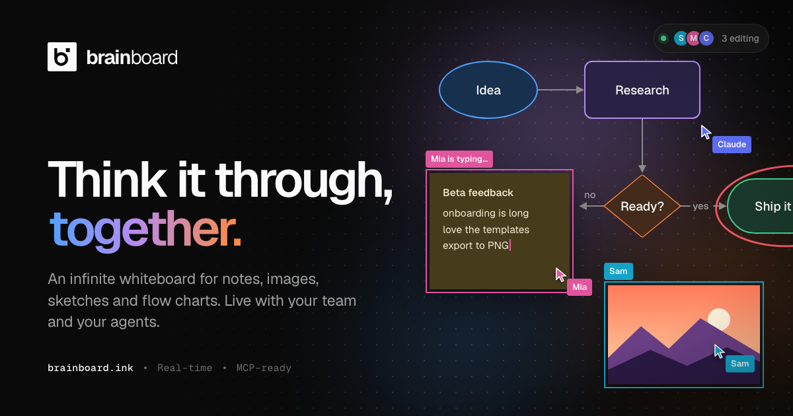
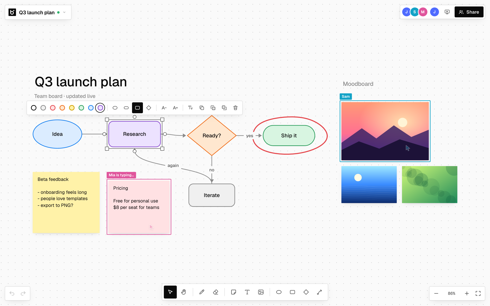

# brainboard

[](https://brainboard.ink)

A minimal, near-infinite whiteboard for notes, images, sketches and flow charts. Invite people to edit with you in real time, drive it from the keyboard with vim keys, and let AI agents read and edit your boards over MCP.

Live at **[brainboard.ink](https://brainboard.ink)**, or run your own: boards are plain JSON files on the server's disk.

## Features

- **Infinite canvas.** Pan and zoom freely. Paste or drop images, write sticky notes and text, and sketch with a pen.
- **Flow charts.** Bubbles, boxes, pills and decisions with curved, labelled connectors. Press `Tab` to grow the next step.
- **Live collaboration.** Invite links that can edit or only view. Everyone's cursor, selection, typing and pen strokes show up live. Talk over built-in voice chat, follow someone, or present to the room.
- **Vim keys.** A `:` command line with completion, `/` search, find and replace, and an optional vim mode with `hjkl` navigation.
- **Agent friendly.** A built-in MCP server lets Claude, Cursor and other agents list, read, render and edit boards. Their edits appear live in your tab.
- **No sign-up wall.** Start drawing straight away. Create an account (with a passkey, or email and password) when you want to keep your boards and open them anywhere.
- **Export anywhere.** PNG, PDF, SVG, a Markdown outline, or a full brainboard file, saved wherever you choose.
- **Yours.** Self-host it in one command. Light and dark themes and per-user undo.


## Quick start

Requires Node 22.18 or newer. The server runs its TypeScript directly, with no build step for the backend.

```sh
git clone https://github.com/ai-armageddon/brainboard.git
cd brainboard
npm install
npm run dev
```

Open http://localhost:5317. A short tour walks you through the basics the first time, and you can replay it from the menu with **Quick tour**.

Opening the address on its own always starts a blank board. It's saved, and gets its own link, the moment you add something, rename it, share it or start a call, so a visit never creates or shows a board. A board's link opens it directly. **All boards** (`⌥B`, or the top of the menu) shows what's live right now, what you opened recently, boards shared with you, and every board you own, with search. Boards shared with you are the ones you joined through an invite link, plus invites the owner addressed to your account's email. Sign in and they follow you to your other devices. Nobody sees a board unless they own it or it was shared with them.

| Command | What it does |
|---|---|
| `npm run dev` | Development server with live reload, on this computer only |
| `npm start` | Production build, on this computer only |
| `npm run share` | Production build that people on your network can reach |
| `npm run prod` | Production build in hosted mode for https://brainboard.ink (see [Deploy](#deploy)) |
| `npm run mcp` | The MCP server on stdio, for AI agents |

Boards are saved in `~/.brainboard/`, with images next to them. Set `BRAINBOARD_DIR` to use another folder. Deleted boards go to `~/.brainboard/trash/`.

To keep the dev server running in the background and across restarts, run it under [pm2](https://pm2.keymetrics.io):

```sh
pm2 start node_modules/.bin/vite --name brainboard-dev
pm2 save
```

## Using the canvas

Shortcuts are written for Mac. On Windows and Linux, `⌘` is `Ctrl` and `⌥` (Option) is `Alt`, and the app shows them that way.

| | |
|---|---|
| **Pan** | Scroll or drag with two fingers, hold `⌘` and drag (`Ctrl` on Windows), hold `Space` and drag, or press `H` |
| **Zoom** | Pinch or `⌘` + scroll · `⇧1` fits everything · `⌘0` resets to 100% |
| **Images** | `⌘V` to paste, drag files in, or press `I` |
| **Write** | Double-click anywhere for text · `N` for a sticky note · `Enter` edits the selection |
| **Draw** | `P` pen · `E` eraser · click or press `+` / `−` for 1 px steps, hold `Shift` and scroll up to grow or down to shrink, or `Shift`-drag left or right on the canvas |
| **Erase** | **Partial** removes ink under the brush. **Whole stroke** removes each pen stroke you touch. Undo restores one eraser gesture. |
| **Flow charts** | `O` bubble · `R` box · `D` decision · `C` connector |
| | Drag a shape's dot onto another shape to connect them, or onto empty space to grow a new bubble. `Tab` adds a connected bubble to the right, even while you type. |
| **Organise** | `⌘D` duplicate · `]` / `[` bring to front or send to back · `⌫` delete |
| **Boards** | `⌥B` all boards · open the menu at the top left · `⌥N` new board · double-click the board name to rename it |
| **Views** | `{` `}` previous / next view · `⌥1`–`⌥9` jump to a view |
| **Export** | `⇧⌘E`, or **Export…** in the menu: PNG (1–3×, transparent if you like), PDF, SVG, a Markdown outline of the text and flow, or a brainboard file you can import again. Pick the whole board or just the selection, and a light or dark theme. **Save as…** lets you choose the folder and file name in Chrome, Edge and Opera. Other browsers save to Downloads |
| **Undo** | `⌘Z` / `⇧⌘Z` undo only *your* changes, never anyone else's |

Press `?` in the app for every shortcut.



## Accounts and saving

Nobody has to sign in. Every browser gets its own private, anonymous space, and the boards you make there are yours.

- **Not saved yet.** Until you create an account, your boards are tied to this browser. If you clear its data or switch devices, they're gone. A **Save** button in the top right shows when this applies. If you head for the tab bar with unsaved work, brainboard shows a short in-app reminder. `⌘S` and `:w` save too.
- **Create an account** with a **passkey** (Face ID, Touch ID or your device PIN, with no password) or with **email and password**. Everything you made in this browser moves into the account.
- **Sign in anywhere** with the same passkey or email to see all your boards. Add more passkeys, rename yourself or sign out from your avatar in the top right.

Passwords are hashed with scrypt, and sessions are random tokens stored only as hashes. Sign-in attempts are rate-limited.

## Collaborate in real time

Click **Share** to create an invite link for each person. Each link either **can edit** or **can view**. The **People** list shows everyone you've invited, whether they're here now or when they were last here, and lets you change what they can do or **Remove** them. Removing someone disconnects them and retires their link, so they can't rejoin with it. Changes apply instantly. You can also remove someone from the menu on their avatar. Collaborating doesn't need an account, just a **screen name**: brainboard asks for one before you share or present, and guests pick theirs when they join. Guests see only the board they were invited to.


- **Presence.** Everyone's cursor, selection and "typing" marker appear in their colour. Choose **Follow** next to Views to see each person's name and current view. Click a name to follow their camera. Open the list again to switch people or stop following.
- **Present.** Everyone follows your view while you walk through the board. You can lock the view so nobody wanders off.
- **Views.** Save an area from the views menu next to the board name. Brainboard suggests a name from the visible content. You can edit it when saving or choose **Rename** later. Hop between views with the arrows or `{` `}`. Views are saved with the board, so everyone sees the same ones. When you aren't following anyone, faces next to the view name show who's working in other views, with a pulse for whoever is active right now. The menu shows who is in each view, and clicking a face takes you to them.
- **Voice chat.** Click **Join voice** to talk. Open the chevron to see who’s in the call, check who’s speaking, or select **Join muted** before joining. The toolbar keeps your mic state and hang-up button visible. In the call panel, **Audio settings** lets you switch microphone or speaker and test your mic level. Audio goes directly between browsers. Your choice is remembered, and if that mic is unplugged you fall back to the system default. Avatars light up and cursors show sound bars while someone talks. The board owner and the presenter can mute anyone, mute everyone, or turn on **Stage mode** in Share so only they can talk. Mutes apply on every listener's side, not just the muted person's. Peer-to-peer audio suits small groups of up to about 8 people.
- **Cinematic follow.** Followers get a calm camera by default. Instead of mirroring every twitch, it frames what the presenter is working on: the note they're typing in, what they just selected, or the item their cursor rests on. It holds still while that's already in view, eases over when it isn't, and flies across the board for long jumps. Switch to **Exact** in the follow banner to mirror their screen instead.
- **Session controls.** *Pause editing* makes everyone else view-only. *Show viewers' cursors* can be turned off for big audiences. Each person has a **Remove** button.
- **Reaching people.** On brainboard.ink, links just work. When you run it yourself, `npm run dev` and `npm start` listen only on your computer. For people on the same Wi-Fi, run `npm run share` and the Share dialog picks your network address. For anyone else, run `npm start` behind a tunnel, for example `cloudflared tunnel --url http://localhost:5317`, and paste the tunnel's address into **Link address**.
- **Security.** Each board belongs to the account or browser that made it. Everyone else needs an invite link. Cross-site requests are refused, and roles are enforced on the server, not just in the UI. When you run it locally, your own computer also sees boards that have no owner, such as older boards and ones AI agents create over MCP.

## Vim keys


These work all the time, because they don't clash with the regular shortcuts:

| | |
|---|---|
| `:` or `;` | Command line. `Tab` completes and `↑` / `↓` scroll through history |
| `/` | Search the board's text as you type. `Enter` keeps the match |
| `u` · `⌃R` | Undo / redo |
| `w` `b` · `gg` `G` | Next or previous item, first or last item, in reading order |
| `a` | Edit the selected item with the cursor at the end |
| `yy` · `x` | Yank or cut the selection |
| `zz` · `zi` `zo` | Centre the selection, zoom in or out |
| `ma` · `'a` · `''` | Mark this view as `a`, jump back to it, return to where you were |
| `gt` · `gT` | Next or previous board |
| `gv` · `:views` | Open saved views |

Turn on **vim mode** with `:set vim` or **Vim keys** in the menu. Press `p` to select the pen in either mode. For tools whose keys become Vim commands, use commands such as `:note` and `:bubble`.

| | |
|---|---|
| `h` `j` `k` `l` | Jump to the nearest item in that direction |
| `H` `J` `K` `L` | Pan the view |
| `i` · `cc` | Edit text with the cursor at the start, or replace it |
| `o` · `O` | New connected bubble below or above |
| `dd` · `gp` `P` | Delete (and yank), put after or before the selection |
| `n` · `N` | Next or previous search match |

Some useful commands:

- `:e {board}` opens a board, with name completion. `:new`, `:file {name}`, `:bn` and `:bp` manage boards.
- `:%s/old/new/g` finds and replaces across the whole board, and `:s/old/new/` does it in the selection. Patterns are JavaScript regular expressions, and `&` and `\1` work in the replacement.
- `:color red`, `:shape decision`, `:zoom 150`, `:fit`, `:theme dark`, `:follow Sam`, `:present`, `:share`, `:export`, `:marks` and `:help`.
- `:w` and `:q` work too, but there's nothing to save: brainboard saves as you go.

## Use it with AI agents (MCP)

brainboard ships an MCP server, so agents such as Claude Code, Claude Desktop and Cursor can list, read, look at and edit your boards. Their edits appear live in your open tab, and you can undo them.

**Claude Code** picks it up automatically inside this folder through `.mcp.json`. To use it from anywhere:

```sh
claude mcp add brainboard --scope user -- node /absolute/path/to/brainboard/server/mcp.ts
```

**Claude Desktop, Cursor and other clients** use this config:

```json
{ "mcpServers": { "brainboard": { "command": "node", "args": ["/absolute/path/to/brainboard/server/mcp.ts"] } } }
```

| Tool | What it does |
|---|---|
| `list_boards` | All boards, most recent first |
| `read_board` | An outline of every note, shape, image and arrow, with ids, positions and the flow between them (or `format: "json"`) |
| `render_board` | A PNG of the board, including drawings and images (`show_ids` overlays ids) |
| `view_image` | Look at a pasted image |
| `add_items` | Add notes, text, bubbles, boxes, decisions and arrows in one call, with automatic layout |
| `update_items` / `delete_items` | Edit or remove items by id |
| `add_image` | Put an image on a board from a file path, URL or base64 |
| `create_board` / `rename_board` | Manage boards |

Try asking: *"Read my Q3 launch plan board and add the next steps as a flow chart"* or *"Look at the screenshot I pasted and summarise it in a sticky note next to it."*

## Empty boards

New boards open with a small animated scene instead of a blank page. It stops as soon as you add something, and holds still if your system asks for reduced motion.


## Deploy

Production runs at **https://brainboard.ink**. Hosted mode turns on when `BRAINBOARD_PUBLIC_URL` is set. It switches off the "this computer is the owner" shortcut, issues `Secure` cookies, and uses the domain for passkeys and invite links.

```sh
npm ci
npm run prod   # builds, then serves on $PORT (default 5317) with BRAINBOARD_PUBLIC_URL=https://brainboard.ink
```

| Variable | Default | Purpose |
|---|---|---|
| `BRAINBOARD_PUBLIC_URL` | unset (local mode) | The public address, e.g. `https://brainboard.ink` |
| `PORT` | `5317` | Port to listen on |
| `HOST` | `0.0.0.0` when hosted | Interface to listen on |
| `BRAINBOARD_DIR` | `~/.brainboard` | Boards, images, accounts and sessions. Back this up |
| `BRAINBOARD_ICE_SERVERS` | Google's public STUN server | JSON list of WebRTC ICE servers for voice chat. Add a TURN server (for example coturn) so voice works on strict corporate networks |

Put it behind HTTPS. A reverse proxy must forward WebSockets and keep the original `Host` header. With [Caddy](https://caddyserver.com):

```
brainboard.ink {
  reverse_proxy 127.0.0.1:5317
}
```

Passkeys only work on the real domain (and on `localhost` in development), not on raw IP addresses. Email sign-in works everywhere.

### Link previews

`index.html` carries Open Graph, X (Twitter) and JSON-LD tags, so a pasted brainboard.ink link unfurls with the card at the top of this README in Slack, iMessage, Discord, LinkedIn and X. The tags point at `https://brainboard.ink`; if you host it on another domain, change the `canonical`, `og:url`, `og:image` and `twitter:image` addresses to yours.

The card (`public/og.png`, 1200×630) is a web page, `scripts/og.html`, drawn with the app's own fonts and colours. Edit it, then redraw the PNG with headless Chrome:

```sh
node scripts/og.ts   # set CHROME=/path/to/chrome if it isn't in the default macOS location
```

App icons and the favicon come from the brand mark in `src/brand.ts`: `node scripts/icons.ts` regenerates them.

## How it works

- **App** (`src/`): vanilla TypeScript and Vite, no framework. The canvas is DOM elements and SVG inside one transformed layer.
- **Server** (`server/`): a small Node HTTP and WebSocket server. Each open board is a room. Clients send item-level changes, the server keeps the room authoritative, and it writes the board file shortly after each change.
- **Agents**: the MCP server edits the same files. The live server notices the change and merges it into the room, so agent edits show up in open tabs.

| File | Role |
|---|---|
| `src/state.ts` · `src/net.ts` | Board state and per-user undo · server connection and live sync |
| `src/render.ts` · `src/input.ts` · `src/actions.ts` · `src/ui.ts` | Canvas, input, operations, interface |
| `src/collab.ts` · `src/vim.ts` · `src/tour.ts` | Presence, follow and sharing · vim keys · first-run tour |
| `src/account.ts` | Sign-in sheet, save reminders, screen names |
| `src/voice.ts` · `src/director.ts` | Voice chat (WebRTC) · cinematic follow camera |
| `server/store.ts` · `server/api.ts` · `server/realtime.ts` | Board and image files · HTTP API · live rooms |
| `server/mcp.ts` · `server/agent.ts` · `server/render.ts` | MCP server · outlines and auto-layout · PNG rendering |
| `server/auth.ts` · `server/sharing.ts` | Who is asking (account, anonymous browser, guest) · board owners and invite links |
| `server/accounts.ts` · `server/passkeys.ts` · `server/config.ts` | Accounts, passwords and sessions · passkeys (WebAuthn) · hosted vs local mode |
| `scripts/og.ts` · `scripts/icons.ts` | Social share card · app icons and favicon |
