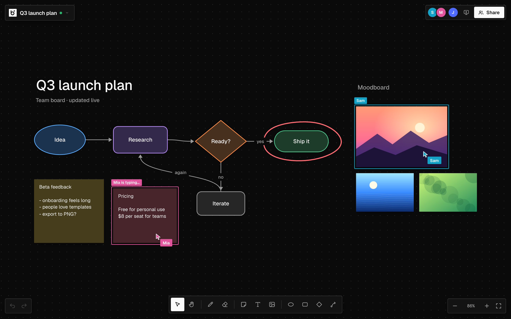
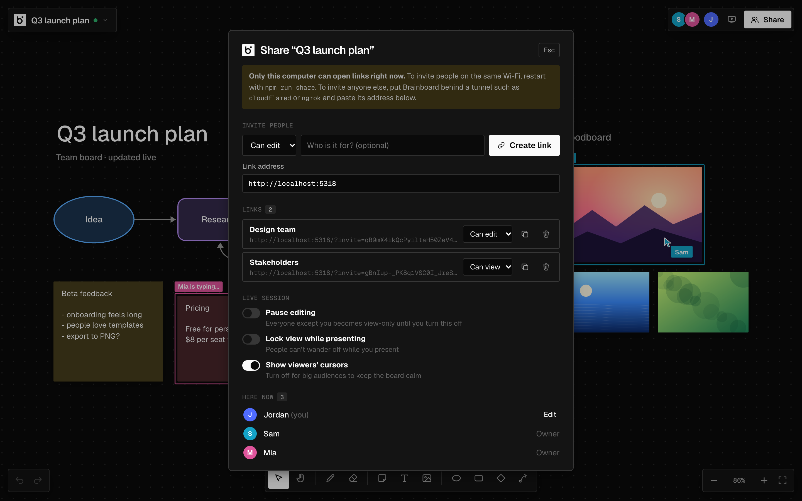
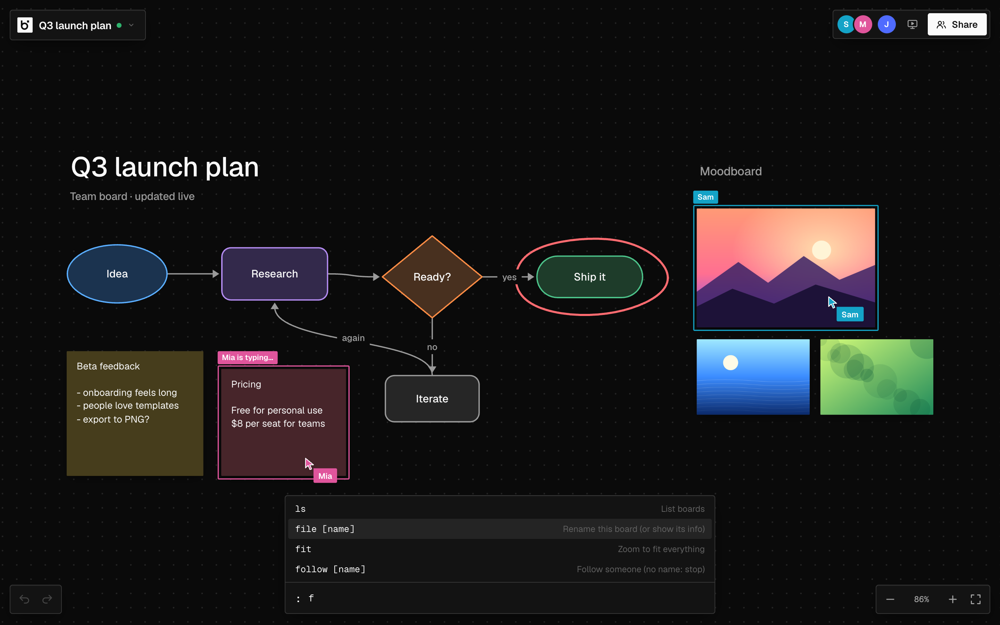
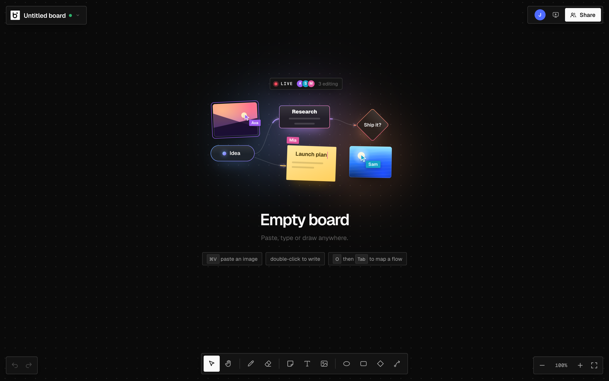

# brainboard

A minimal, near-infinite whiteboard for notes, images, sketches and flow charts. Invite people to edit with you in real time, drive it from the keyboard with vim keys, and let AI agents read and edit your boards over MCP.

Self-hosted and local-first: boards are plain JSON files on your own disk.



## Features

- **Infinite canvas.** Pan and zoom freely. Paste or drop images, write sticky notes and text, and sketch with a pen.
- **Flow charts.** Bubbles, boxes, pills and decisions with curved, labelled connectors. Press `Tab` to grow the next step.
- **Live collaboration.** Invite links that can edit or only view. Everyone's cursor, selection and typing shows up live, and you can follow someone or present to the room.
- **Vim keys.** A `:` command line with completion, `/` search, find and replace, and an optional vim mode with `hjkl` navigation.
- **Agent friendly.** A built-in MCP server lets Claude, Cursor and other agents list, read, render and edit boards. Their edits appear live in your tab.
- **Yours.** No account, no cloud. Light and dark themes, per-user undo, and JSON export.

## Quick start

Requires Node 22.18 or newer. The server runs its TypeScript directly, with no build step for the backend.

```sh
git clone https://github.com/ai-armageddon/brainboard.git
cd brainboard
npm install
npm run dev
```

Open http://localhost:5317. A short tour walks you through the basics the first time, and you can replay it from the menu with **Quick tour**.

| Command | What it does |
|---|---|
| `npm run dev` | Development server with live reload, on this computer only |
| `npm start` | Production build, on this computer only |
| `npm run share` | Production build that people on your network can reach |
| `npm run mcp` | The MCP server on stdio, for AI agents |

Boards are saved in `~/.brainboard/`, with images next to them. Set `BRAINBOARD_DIR` to use another folder. Deleted boards go to `~/.brainboard/trash/`.

## Using the canvas

| | |
|---|---|
| **Pan** | Scroll or drag with two fingers, hold `Space` and drag, or press `H` |
| **Zoom** | Pinch or `⌘` + scroll · `⇧1` fits everything · `⌘0` resets to 100% |
| **Images** | `⌘V` to paste, drag files in, or press `I` |
| **Write** | Double-click anywhere for text · `N` for a sticky note · `Enter` edits the selection |
| **Draw** | `P` pen · `E` eraser |
| **Flow charts** | `O` bubble · `R` box · `D` decision · `C` connector |
| | Drag a shape's dot onto another shape to connect them, or onto empty space to grow a new bubble. `Tab` adds a connected bubble to the right, even while you type. |
| **Organise** | `⌘D` duplicate · `]` / `[` bring to front or send to back · `⌫` delete |
| **Boards** | Open the menu at the top left · `⌥N` new board · double-click the board name to rename it |
| **Undo** | `⌘Z` / `⇧⌘Z` undo only *your* changes, never anyone else's |

Press `?` in the app for every shortcut.


## Collaborate in real time

Click **Share** to create invite links. Each link either **can edit** or **can view**, and you can change or revoke it at any time. Changes apply instantly to everyone using that link. Guests choose a name and colour and see only the board they were invited to.



- **Presence.** Everyone's cursor, selection and "typing" marker appear in their colour. Click an avatar to follow that person's view.
- **Present.** Everyone follows your view while you walk through the board. You can lock the view so nobody wanders off.
- **Session controls.** *Pause editing* makes everyone else view-only. *Show viewers' cursors* can be turned off for big audiences. Each person has a **Remove** button.
- **Reaching people.** `npm run dev` and `npm start` listen only on your computer. For people on the same Wi-Fi, run `npm run share` and the Share dialog picks your network address. For anyone else, run `npm start` behind a tunnel, for example `cloudflared tunnel --url http://localhost:5317`, and paste the tunnel's address into **Link address**.
- **Security.** Requests from your own computer are the owner. Everyone else needs an invite link, or the private owner link that `npm run share` prints. Cross-site requests are refused, and roles are enforced on the server, not just in the UI.

## Vim keys



These work all the time, because they don't clash with the regular shortcuts:

| | |
|---|---|
| `:` or `;` | Command line. `Tab` completes and `↑` / `↓` scroll through history |
| `/` | Search the board's text as you type. `Enter` keeps the match |
| `u` · `⌃R` | Undo / redo |
| `w` `b` · `gg` `G` | Next or previous item, first or last item, in reading order |
| `a` | Edit the selected item with the cursor at the end |
| `yy` · `x` | Yank or cut the selection |
| `zz` · `zi` `zo` | Centre the selection, zoom in or out |
| `ma` · `'a` · `''` | Mark this view as `a`, jump back to it, return to where you were |
| `gt` · `gT` | Next or previous board |

Turn on **vim mode** with `:set vim` or **Vim keys** in the menu. It adds the keys that normally pick a tool, so the tools move to commands such as `:pen`, `:note` and `:bubble`.

| | |
|---|---|
| `h` `j` `k` `l` | Jump to the nearest item in that direction |
| `H` `J` `K` `L` | Pan the view |
| `i` · `cc` | Edit text with the cursor at the start, or replace it |
| `o` · `O` | New connected bubble below or above |
| `dd` · `p` `P` | Delete (and yank), put after or before the selection |
| `n` · `N` | Next or previous search match |

Some useful commands:

- `:e {board}` opens a board, with name completion. `:new`, `:file {name}`, `:bn` and `:bp` manage boards.
- `:%s/old/new/g` finds and replaces across the whole board, and `:s/old/new/` does it in the selection. Patterns are JavaScript regular expressions, and `&` and `\1` work in the replacement.
- `:color red`, `:shape decision`, `:zoom 150`, `:fit`, `:theme dark`, `:follow Sam`, `:present`, `:share`, `:export`, `:marks` and `:help`.
- `:w` and `:q` work too, but there's nothing to save: brainboard saves as you go.

## Use it with AI agents (MCP)

brainboard ships an MCP server, so agents such as Claude Code, Claude Desktop and Cursor can list, read, look at and edit your boards. Their edits appear live in your open tab, and you can undo them.

**Claude Code** picks it up automatically inside this folder through `.mcp.json`. To use it from anywhere:

```sh
claude mcp add brainboard --scope user -- node /absolute/path/to/brainboard/server/mcp.ts
```

**Claude Desktop, Cursor and other clients** use this config:

```json
{ "mcpServers": { "brainboard": { "command": "node", "args": ["/absolute/path/to/brainboard/server/mcp.ts"] } } }
```

| Tool | What it does |
|---|---|
| `list_boards` | All boards, most recent first |
| `read_board` | An outline of every note, shape, image and arrow, with ids, positions and the flow between them (or `format: "json"`) |
| `render_board` | A PNG of the board, including drawings and images (`show_ids` overlays ids) |
| `view_image` | Look at a pasted image |
| `add_items` | Add notes, text, bubbles, boxes, decisions and arrows in one call, with automatic layout |
| `update_items` / `delete_items` | Edit or remove items by id |
| `add_image` | Put an image on a board from a file path, URL or base64 |
| `create_board` / `rename_board` | Manage boards |

Try asking: *"Read my Q3 launch plan board and add the next steps as a flow chart"* or *"Look at the screenshot I pasted and summarise it in a sticky note next to it."*

## Empty boards

New boards open with a small animated scene instead of a blank page. It stops as soon as you add something, and holds still if your system asks for reduced motion.



## How it works

- **App** (`src/`): vanilla TypeScript and Vite, no framework. The canvas is DOM elements and SVG inside one transformed layer.
- **Server** (`server/`): a small Node HTTP and WebSocket server. Each open board is a room. Clients send item-level changes, the server keeps the room authoritative, and it writes the board file shortly after each change.
- **Agents**: the MCP server edits the same files. The live server notices the change and merges it into the room, so agent edits show up in open tabs.

| File | Role |
|---|---|
| `src/state.ts` · `src/net.ts` | Board state and per-user undo · server connection and live sync |
| `src/render.ts` · `src/input.ts` · `src/actions.ts` · `src/ui.ts` | Canvas, input, operations, interface |
| `src/collab.ts` · `src/vim.ts` · `src/tour.ts` | Presence, follow and sharing · vim keys · first-run tour |
| `server/store.ts` · `server/api.ts` · `server/realtime.ts` | Board and image files · HTTP API · live rooms |
| `server/mcp.ts` · `server/agent.ts` · `server/render.ts` | MCP server · outlines and auto-layout · PNG rendering |
| `server/auth.ts` · `server/sharing.ts` | Owner and guest access, invite links |
